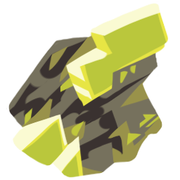

<sub> If you're viewing this in VSCode, it's recommended that you open it in a
preview with `Ctrl+Shift+V`! </sub>

<br>

<center>
  <h2 style="font-size: 42px">
    
    <b>Uranium Template</b>
  </h2>
  <em style="font-family: 'Comic Sans MS', 'Comic Sans', Impact, Arial">Official manual!!!! (Now for v2!!!!)</em>
</center>
<br>

**Uranium Template** is a low-level generic template for NotITG v4.9+. In
particular, it's specialized towards non-modfile development, including
minigames, file selectors, and other meta projects.

The design is pretty closely based off of the design of code-only engines like
Love2D, and the goal is to provide a solid base to develop anything with a
similar philosophy on top.

Uranium Template originally formed during the creation of a currently unreleased
project, and v2 formed during the creation of the [Mod Jam Kusoge lobby](https://www.youtube.com/watch?v=CSJ_pimhrYA).
Since then I've refined and polished it up to be usable on its own. Most of the
design decisions came from experience using prototype versions of it!

<b style="font-size: 42px">TODO this is super unupdated for v2</b>

- [Installation](#installation)
- [Distribution](#distribution)
- [How do I start writing code?](#how-do-i-start-writing-code)
- [Requiring files](#requiring-files)
  - [Namespaces](#namespaces)
  - [`package` module](#package-module)
- [Defining actors](#defining-actors)
  - [Initializing actors](#initializing-actors)
  - [A note on proxies](#a-note-on-proxies)
    - [Miscellaneous proxy notes](#miscellaneous-proxy-notes)
  - [Actor-specific notes](#actor-specific-notes)
    - [`ActorFrameTexture`](#actorframetexture)
    - [`ActorFrame`](#actorframe)
    - [`ActorScroller`](#actorscroller)
    - [`BitmapText`](#bitmaptext)
  - [Textures](#textures)
  - [Shaders](#shaders)
- [Callback usage](#callback-usage)
  - [Default callbacks](#default-callbacks)
    - [`update(dt: number)`](#updatedt-number)
    - [`init()`](#init)
    - [`ready()`](#ready)
    - [`exit()`](#exit)
    - [`focus(hasFocus: boolean)`](#focushasfocus-boolean)
  - [Loading stage order](#loading-stage-order)
  - [Custom callbacks](#custom-callbacks)
  - [Advanced usage](#advanced-usage)
- [Configuration](#configuration)
    - [`hideThemeActors: boolean`](#hidethemeactors-boolean)
- [Standard library](#standard-library)
  - [`aft`](#aft)
    - [`aft.setupSprite(sprite: Sprite)`](#aftsetupspritesprite-sprite)
    - [`aft.createSprite(ctx: Context): Sprite`](#aftcreatespritectx-context-sprite)
    - [`aft.setupAFT(aft: ActorFrameTexture)`](#aftsetupaftaft-actorframetexture)
    - [`aft.createAFT(ctx: Context): ActorFrameTexture`](#aftcreateaftctx-context-actorframetexture)
    - [`aft.createEffectStack(ctx: Context): ActorFrameTexture, Sprite`](#aftcreateeffectstackctx-context-actorframetexture-sprite)
  - [`binser`](#binser)
  - [`ease`](#ease)
  - [`env`](#env)
    - [`env.inEditor: boolean`](#envineditor-boolean)
    - [`env.onWine: boolean`](#envonwine-boolean)
  - [`eternalfile`](#eternalfile)
  - [`eventhandler`](#eventhandler)
    - [`EventHandler.new(name: string?): EventHandler`](#eventhandlernewname-string-eventhandler)
    - [`EventHandler:call(event: string, ...)`](#eventhandlercallevent-string-)
    - [`EventHandler:on(event: string, f: function)`](#eventhandleronevent-string-f-function)
    - [`EventHandler:subhandler(name: string?): EventHandler`](#eventhandlersubhandlername-string-eventhandler)
    - [`EventHandler:orphan()`](#eventhandlerorphan)
  - [`input`](#input)
    - [Input types](#input-types)
    - [`input.isDown(i: string, pn: number?): boolean`](#inputisdowni-string-pn-number-boolean)
      - [Events](#events)
        - [`press(input: inputType, pn: number)`](#pressinput-inputtype-pn-number)
        - [`release(input: inputType, pn: number)`](#releaseinput-inputtype-pn-number)
    - [A note about keyboard inputs](#a-note-about-keyboard-inputs)
  - [`mirin`](#mirin)
  - [`players`](#players)
  - [`savedata`](#savedata)
    - [`savedata.init(name: string)`](#savedatainitname-string)
    - [`savedata.s(data: table, name: string?): table`](#savedatasdata-table-name-string-table)
    - [`savedata.load()`](#savedataload)
    - [`savedata.save(instant: boolean?)`](#savedatasaveinstant-boolean)
    - [`savedata.getLastSave(): string[] | nil`](#savedatagetlastsave-string--nil)
    - [`savedata.enableAutosave()`](#savedataenableautosave)
    - [`savedata.saveNextFrame: boolean`](#savedatasavenextframe-boolean)
      - [Events](#events-1)
        - [`save()`](#save)
        - [`saveFinished()`](#savefinished)
  - [`tick`](#tick)
    - [`Tick.new()`](#ticknew)
    - [`Tick:update(dt: number)`](#tickupdatedt-number)
    - [`Tick:func(delay: number, func: function, ...)`](#tickfuncdelay-number-func-function-)
    - [`Tick:perframe(delay: number, dur: number, func: function)`](#tickperframedelay-number-dur-number-func-function)
    - [`Tick:ease(delay: number, dur: number, ease: function, from: number, to: number, func: function)`](#tickeasedelay-number-dur-number-ease-function-from-number-to-number-func-function)
    - [`Tick:lock(callback: function?)`](#ticklockcallback-function)
    - [`Tick:aux(default: number): Aux`](#tickauxdefault-number-aux)
    - [`Aux:ease(delay: number, duration: number, ease: function, value: number)`](#auxeasedelay-number-duration-number-ease-function-value-number)
    - [`Aux:add(delay: number, duration: number, ease: function, value: number)`](#auxadddelay-number-duration-number-ease-function-value-number)
- [Examples](#examples)
  - [The obligatory](#the-obligatory)
  - [Simple platformer base](#simple-platformer-base)
  - [AFTs](#afts)
  - [Shader test](#shader-test)
  - [Savedata example](#savedata-example)
  - [Simple ActorFrame setup](#simple-actorframe-setup)
- [Credits](#credits)

## Installation

Installation is the exact same as any other NotITG template:

0. Get the latest template version from [the Gitea releases page](https://git.oat.zone/oat/uranium-template/releases)
1. Unzip your installation zip, as you would a modfile
2. Edit `Song.sm` in your editor of choice (ArrowVortex, NotITG, Notepad, ...)
to include necessary metadata; replace `silence.ogg` with an actual track, if
necessary
3. Edit `main.lua` to do whatever you wish to do with it! The entirety of the
`src/` folder is yours!
4. _(Recommended)_ Install [LuaLS](https://luals.github.io/#install)
([VSCode](https://marketplace.visualstudio.com/items?itemName=sumneko.lua),
[JetBrains IDEs](https://plugins.jetbrains.com/plugin/22315-sumnekolua)) and
grab the latest NotITG typings from
[here](https://gitlab.com/CraftedCart/notitg_docs/-/archive/master/notitg_docs-master.zip?path=lua)
(put them in a folder like `.typings`!). Uranium comes with typings for its own
libraries and modules, which work best when NotITG typings are also available to
the language server.

## Distribution

After you're done with writing your file, be sure to take these steps to reduce
the filesize and get your file ready for zipping up!

- Remove `distribute-file.sh`, `MANUAL.md`, `docs/`, `.vscode/`, `.gitconfig`
and `.gitignore`. These are files that aren't necessary outside of a development environment!
- Remove `Song.sm.auto` and `Song.sm.old` if your chart editor left
them over from an earlier edit.
- If you've added NotITG typings during installation, be sure to remove your 
typings folder (likely `.typings`)
- If you're using Git, **PLEASE REMOVE YOUR `.git/` FOLDER!!!**

If you're on Linux or have MSYS2/WSL/similar installed, you can use the
[distribution script](distribute-file.sh).

Afterwards, it should be safe to zip everything up and send it over!

## How do I start writing code?

`src/main.lua` is the entry-point for your code! From there, you can do anything
you'd like to do with the modfile.

If you're still a bit clueless, why not check out the [Examples](#examples)
section?

## Requiring files

`require` in Uranium works a lot like Lua's vanilla `require`, and is a direct
copy of Mirin's `require`.

Say you have a file structure like this:

`src/main.lua`
```lua
local value = require 'test'
print(value)
```

`src/test.lua`
```lua
return 'hello!'
```

Your setup would print `'hello!'`.

### Namespaces

Uranium has two default defined namespaces: `uranium` and `stdlib`. `uranium`
holds interfaces to and from the template; this is what you'll pull in to define
actors, listen to default events, and configure the template. `stdlib` is the
Uranium standard library, holding various optional libraries you can pull in for
personal ease of use.

### `package` module

Uranium also includes a `package` module as a global. It implements a subset of
the methods/fields that Lua's default `package` module provides. It provides one
extra field, `base`, which is a shorthand for
`GAMESTATE:GetCurrentSong():GetSongDir()`.

## Defining actors

Actors are defined in Uranium Template before any other callback runs, and are
defined by functions under a `Context`:

```lua
local uranium = require 'uranium'
local ctx = uranium.ctx

local quad = ctx:Quad()
local sprite = ctx:Sprite('file/location.png')
local text = ctx:BitmapText('common', 'hello, world!')
```

For convenience purposes, you may define `ctx` as a global to avoid redefining
it in every newly required module. Every example from here on out will assume
`ctx` is defined as such:

```lua
ctx = require('uranium').ctx
```

Defining actors during runtime (after `init`) is forbidden and will return in
an error:

```lua
events:on('init', function()
  local quad = ctx:Quad() -- actor235: attempting to modify actor queue while it is locked. did you call 'lock' too early?
end)
```

All actors that take in filenames have their filenames starting from the root of
the project; meaning if you had a file in `Songs/Modfile/src/test.png`, you'd
have to pass in a filename of `src/test.png`. **If an image is blank, or a
single pink pixel, it hasn't loaded properly.**

### Initializing actors

Once you have an actor defined, you can run whatever methods you want to set
initial values.

```lua
local text = ctx:BitmapText('common', 'hello, world!')
text:xy(scx, scy)
text:zoom(2.3)
text:rotationz(30)
text:diffuse(1, 0.8, 0.8, 1)
```

These will come into effect as soon as the actor is initialized; think of it as
an `InitCommand`.

### A note on proxies

Even though what you may think you get a fully functional actor, what you
actually get is a _proxied actor_ (not to be confused with NotITG's
`ActorProxy`). Due to a quirk of NotITG, unlike what Uranium's initialization
wrapping would have you believe, there is no method for creating actors during
runtime. Instead, when a method under `ctx` is called, that actor is committed
to the _actor queue_ that's then used after loading your `main.lua` to construct
the actor tree.

What this means in practice is that the actors you get will not be real actors,
but rather proxies:

```lua
local quad = ctx:Quad()
print(quad) --> Proxy of Quad (unresolved)
```

The `(unresolved)` in this means that the real actor this proxy stands in for
has yet to be created, so any getter calls for it will dummy out and return
`nil`:

```lua
print(quad:GetX()) --> nil
```

However, after the `init` event, it will be filled in with its awaited actor:

```lua
events:on('init', function()
  print(quad) --> Proxy of Sprite (0D42AC40)
  print(quad:GetX()) --> 0
end)
```

For convenience, defining an `InitCommand` with `addcommand` will also have the
same behavior:

```lua
quad:addcommand('Init', function()
  print(quad) --> Proxy of Sprite (0D42AC40)
end)
```

As a consequence of Uranium actors being proxies and not native NotITG actors,
you cannot pass them into native NotITG calls without first stripping the proxy.
This can be done by requiring the `Proxy` class from `uranium.actors.proxy`:

```lua
local Proxy = require 'uranium.actors.proxy'

local sprite = ctx:Sprite('src/assets/she.png')
local sine = ctx:Shader('src/glsl/sine.frag')

events:on('init', function()
  sprite:SetShader(Proxy.getRaw(sine))
end)
```

This should mainly be necessary only with the `Shader` and `Texture`
initializers, however, as all other actors never really need to be passed into
other functions.

Not doing so will result in warnings, AVs or silent failures. For instance, with
shaders, the following line is printed in the log, and the shader does not
apply:

```
WARNING: LunaActor::SetShader(): The given shader is null!
```

#### Miscellaneous proxy notes

The `Proxy` class mentioned above holds a few other more obscure utilities for
working with proxied actors:

- You can check if an actor is a native NotITG class or a proxied actor with
`isProxy`:

  ```lua
  local quad = ctx:Quad()
  Proxy.isProxy(quad) --> true
  Proxy.isProxy(SCREENMAN:GetTopScreen()) --> false
  ```
- If you want to store data on a `Proxy`, you can make use of Uranium's internal
data store:

  ```lua
  Proxy.setData(quad, 'foo', 'bar')
  Proxy.getData(quad, 'foo') --> 'bar'
  ```

  Do note that Uranium will also use this store for certain behavior, which will
use the same context as your own data.

### Actor-specific notes

#### `ActorFrameTexture`

AFTs in Uranium work in the same way as usual AFTs: they capture everything that
was drawn to the screen before them. However, this also translates quite
directly to the recommended DrawFunction workflow:

```lua
quad:Draw() -- will be drawn to the AFT

aft:Draw()

sprite:Draw() -- will not be drawn to the AFT
```

In this case, the definition order of the actor does not matter, and you can
dynamically swap the `Draw` call order as you wish.

See [the AFT example](#afts) for a quick setup to play around with, or the
example in the [`aft` library](#aft) for a barebones setup.

#### `ActorFrame`

To create an `ActorFrame`, first define it as a regular actor, then create a
_sub-context_ from it:

TODO move context to its own module

```lua
local Context = require('uranium.actors').Context

local af = ctx:ActorFrame()
local subCtx = Context.getContext(af)
```

Any actors created under that sub-context will be nested into the ActorFrame:

```lua
local quad = subCtx:Quad()

local subAf = subCtx:ActorFrame()
local subSubCtx = Context.getContext(subAf)
local deeplyNestedQuad = subSubCtx:Quad()
```

#### `ActorScroller`

`ActorScroller`s are current unsupported. I don't know if they ever will be.

#### `BitmapText`

TODO fix and document absolute/relative font paths

### Textures

For convinience, `Texture` is a function that will give you a `RageTexture` from
a filename without the actor. Equivalent to:

```lua
local sprite = ctx:Sprite('filename.png')
sprite:hidden(1)
local texture = sprite:GetTexture()
return texture
```

### Shaders

In Uranium, shaders are defined entirely seperately from actors, and then
assigned onto the actors afterwards.

```lua
local sprite = ctx:Sprite('src/assets/she.png')
local sine = ctx:Shader('src/glsl/sine.frag')

events:on('init', function()
  sprite:SetShader(Proxy.getRaw(sine))
end)
```

Defining vertex shaders is done the same way, except with the second argument
instead:

```lua
local shader = ctx:Shader('src/shader.frag', 'src/shader.vert')
```

To define a vertex shader and nothing else, you'll need to omit the fragment
shader and put a `nil` in its place:

```lua
local shader = ctx:Shader(nil, 'src/shader.vert')
```

If you prefer, you can also inline shader code, as long as you don't mix files
with inlined code in the same shader set:

```lua
local shader = ctx:Shader([[
  #version 120

  void main() {
    gl_FragColor = vec4(0.420, 0.69, 1.0, 1.0);
  }
]])
```

And last, if you want a no-op shader, you can just do a simple argumentless
call:

```lua
local noopShader = ctx:Shader()
```

Check [the shader example](#shader-test) if you just want something to play
around with.

## Callback usage

Callbacks are defined with the `uranium.events` module:

```lua
local events = require 'uranium.events'

events:on('update', function()
  -- updates every frame
end)
```

Callbacks are ran in order of definition. Because this is rather finnicky, in
situations where you're expected to pay attention to execution order of even
callbacks, it's recommended to build your own execution order on top of a single
callback:

```lua
events:on('update', function()
  if isMenuOpen() return end
  runPreUpdate()
  runUpdate()
  runPostUpdate()
end)
```

If you return a value in a callback, it'll cancel every other callback after it.
This can be useful for, eg. capturing inputs and ensuring they don't get passed
through to other callbacks on accident. The value will then be returned to the
callback caller.

### Default callbacks

These are the callbacks that are built into Uranium:

#### `update(dt: number)`
Called every frame. `dt` is the time passed since the last frame, the
"deltatime".

#### `init()`
Called once on `OnCommand`. Every actor has been created, and the game should be
starting shortly.

#### `ready()`
Fired on the first tick. A later version of `init()` where more things should be
safe to use; for instance, players are safe to be referenced here.

#### `exit()`
_Should_ call when the player exits the file. **This is an incredibly
inconsistent and hacky event**, and you should never be relying on it.

#### `focus(hasFocus: boolean)`
Called whenever the window loses/gains focus. Convenient event shim for the
`WindowFocus` and `WindowFocusLost` commmands.

### Loading stage order

As a brief overview, it may be helpful to know exactly what Uranium's
initalization and load process looks like to know which events do what.

Uranium loads code in 4 stages:

- **Load**: The template Lua is loaded by the engine, and the template then
  loads your `main.lua`. During this stage, you're able to define actors with
  `uranium.ctx`, but they will only begin being created during the next stage.
- **Init**: The engine is now walking through `actors.xml` and calling the
  actors' `InitCommmand`s one by one. This runs any queued methods on those
  actors.
- **On**: Every actor in the screen has now been created and is safe to access.
  The `init` event is called here.
- **Ready**: At the beginning of the first update tick in ScreenGameplay, the
  engine calls the Ready commmand to signal that the song is now starting. This
  is the stage at which players are safe to reference. The `ready` event is
  called here.

After initialization completes, the `update` event is fired every tick until the
modfile ends or is exited. This isn't technically an initialization stage, but
can be referred to as the **runtime** stage.

### Custom callbacks

Custom callbacks require no extra setup. Define your callback like usual:

```lua
events:on('somethingHappened', function(value)
  -- ...
end)
```

Then all you need to do to call it is:

```lua
events:call('somethingHappened', value)
```

Callbacks support variable arguments, so you can put in as many arguments in as
you like.

### Advanced usage

Uranium's event system uses the [`EventHandler`](#eventhandler) class, which you
can check the documentation of for further usage notes.

## Configuration

Uranium Template's base functionality can be configured using `uranium.config`:

```lua
local config = require 'uranium.config'
config.hideThemeActors = false
```

#### `hideThemeActors: boolean`

Toggle if theme actors (lifebars, scores, song names, etc.) are hidden. Must be
toggled **before** `init`. _(Default: `true`)_

## Standard library

The Uranium Template standard library is split up into several modules. This
section aims to comprehensively document them all.

> [!NOTE]
> Several of Uranium's default modules have disappeared since v2. The
> reason being that maintaining them in Uranium felt rather pointless, and I'd
> rather users make the choice for most of those libraries anyways.
>
> They can still be found in [my personal Lua module
> repo](https://github.com/oatmealine/jadelib), although with less
> documentation and support.

### `aft`

An AFT setup library, for convenience.

```lua
local aftlib = 'stdlib.aft'

-- aftSprite is a Sprite, set to the texture of aft, an ActorFrameTexture
local aft, aftSprite = aftlib.createEffectStack(ctx)
```

#### `aft.setupSprite(sprite: Sprite)`

Sets up a Sprite for textures from AFTs, scaling it with the display resolution.

#### `aft.createSprite(ctx: Context): Sprite`

Creates a Sprite for textures from AFTs, scaling it with the display resolution.
Like `setupSprite`, but includes creating the Sprite from a Context.

#### `aft.setupAFT(aft: ActorFrameTexture)`

Sets up an AFT that will capture the entire scene when drawn.

#### `aft.createAFT(ctx: Context): ActorFrameTexture`

Creates an AFT that will capture the entire scene when drawn. Like `setupAFT`,
but includes creating the AFT from a Context.

#### `aft.createEffectStack(ctx: Context): ActorFrameTexture, Sprite`

Creates an AFT with `createAFT`, a sprite with `createSprite`, and assigns the
sprite a texture from the AFT, returning both in that order.

### `binser`

A NotITG Lua port of [binser](https://github.com/bakpakin/binser). Used for
[savedata](#savedata) serialization.

### `ease`

_Exports globals_

A direct copy of [Mirin Template's
`ease.lua`](https://github.com/XeroOl/notitg-mirin/blob/master/template/ease.lua),
for convinience. See the docs for those
[**here**](https://xerool.github.io/notitg-mirin/docs/eases.html).

### `env`

Small module that contains a bit of information about the user's environment.

#### `env.inEditor: boolean`

Is `true` if the file is being played in the editor. Useful for debugging stuff.

#### `env.onWine: boolean`

Is `true` if the player is playing NotITG through Wine or derivative
compatibility tools like Proton or Crossover.

### `eternalfile`

A module which when imported turns your file into an eternal, neverending file,
until the player puts it out of its misery by exiting. The current beat will
always go from 0 to 1 and start over once this is enabled. This also sets the
notedata to nothing to avoid hitting padding mines.

```lua
require 'stdlib.eternalfile'
```

### `eventhandler`

A generic event handler with support for instanced handlers, subhandlers and
early returns. An instance of this class is used for the `uranium.events`
default events handler.

This module exports a single class, which is `EventHandler`, documented below.

#### `EventHandler.new(name: string?): EventHandler`

Creates a new `EventHandler`. The name is optional, but is stored for your own
use and shows up in `tostring` calls.

#### `EventHandler:call(event: string, ...)`

Call a defined callback. Returns the first value that any callback returns.

#### `EventHandler:on(event: string, f: function)`

Register a callback handler.

#### `EventHandler:subhandler(name: string?): EventHandler`

Create a subhandler, passing all the events of this handler to it.

```lua
local handler = EventHandler.new()
local subhandler = handler:subhandler()

-- callbacks returned early in the subhandler don't affect the parent

subhandler:on('event', function()
  print('a')
  return
end)
subhandler:on('event', function()
  print('b')
  return
end)
handler:on('event', function()
  print('c')
  return
end)

handler:call('event') --> 'a', 'c'
```

#### `EventHandler:orphan()`

Orphan a subhandler, not letting it recieve events from its parent anymore.

### `input`

`input` is the library that handles everything input-related. It provides the
`press` and `release` callbacks under its event handler.

Inputs do not get duplicated if BothAtOnce is on, so if this is your desired
behavior, you should implement this manually.

#### Input types

The `input` module can detect every input that the game can pass through the
[`StepP<player><input><action>MessageCommand`](https://craftedcart.gitlab.io/notitg_docs/message_commands.html#stepp-player-input-action-messagecommand).
Here are the possible values (and default binds, for convenience):

| Input       | P1              | P2      | Notes |
| ----------- | --------------- | ------- | ----- |
| Left        | Left            | KP4     | |
| Down        | Down            | KP2     | |
| Up          | Up              | KP8     | |
| Right       | Right           | KP6     | |
| MenuStart   | Enter           | KPEnter | written in-game as 'Start'. `MenuStart` may sound like a distinct input from a theoretical `Start`, but no such input exists |
| Select      | RShift          | KP0     | |
| Back        | Esc             | NumLock | doesn't register, as it will cause you to back out of the file |
| Coin        | F1              |         | written in-game as 'Insert Coin' |
| Operator    | Insert, ScrLock |         | doesn't register, as it will cause you to back out of the file |
| UpLeft      |                 | Num7    |  |
| UpRight     |                 | Num9    |  |
| MenuLeft    | Delete          | KP/     |  |
| MenuDown    | End             | KP+     |  |
| MenuUp      | Home            | KP-     |  |
| MenuRight   | PgDn            | KP*     |  |
| ActionLeft  |                 |         | also prev. known as `BullshitLeft` |
| ActionDown  |                 |         | also prev. known as `BullshitDown` |
| ActionUp    |                 |         | also prev. known as `BullshitUp` |
| ActionRight |                 |         | also prev. known as `BullshitRight` |
| Action1     | 1               |         |  |
| Action2     | 2               |         |  |
| Action3     | 3               |         |  |
| Action4     | 4               |         |  |
| Action5     | 5               |         |  |
| Action6     | 6               |         |  |
| Action7     | 7               |         |  |
| Action8     | 8               |         |  |

#### `input.isDown(i: string, pn: number?): boolean`

Checks if an input is currently held down. If `pn` is not provided, players are
ignored and it checks if either of the players have the input held down.

##### Events

Accessed under `input.events`, here are the available events:

###### `press(input: inputType, pn: number)`

Called when a player presses on a certain key.

###### `release(input: inputType, pn: number)`

Same as [`press`](#pressinput-inputtype-pn-number), except for releasing a key.

#### A note about keyboard inputs

Working with left/down/up/right inputs can be tiring at times and it's hard to
always fit designs to work with them. However, if you're willing to take a
little compromise, you can also _access all keyboard inputs_. However, it's
worth noting that this **depends on NotITG's Simply Love** (any forks will work
fine too) both for your development environment and for all players; so ideally,
you should only use this for debugging and development tools.

```lua
-- check if the user is using simply love at all
if not stitch then return end

local keyboard = stitch('lua.keyboard')

-- table that contains every keyboard key as the key and a boolean as the value
local buffer = keyboard.buffer
-- for example:
local isDebugKeyHeld = buffer['F3']

-- contains booleans for shift, ctrl, alt, win and altgr
local special = keyboard.special
local isDebugKeyAndShiftHeld = isDebugKeyHeld and special.shift
```

### `mirin`

_Exports globals_

A copy of the [Mirin Template by
XeroOl](https://github.com/XeroOl/notitg-mirin/) (currently at 5.0.1), shoved in
and ported for your convinience. Works exactly the same as regular Mirin.

### `players`

Pulls in player actors as a table of `player number -> Player`. These players
are also proxies, similar to actors created with Contexts, except that they only
resolve on the [`ready`](#ready) event instead of the [`init`](#init) event.

There are 8 actors in the table. Players may not exist if the player has entered
singleplayer (P2, P4, P6, P8 if they entered the P1 side, and P1, P3, P5, P7 if
they entered the P2 side); thus, you should not consider iterating over this
table with `ipairs` safe unless your file has an explicit 2P check.

```lua
local players = require 'stdlib.players'
players[1]:hidden(1)
players[2]:hidden(1)
```

### `savedata`

A complete library for saving and loading arbitrary data to the user's profile.
Uses [binser](#binser) for serialization. See [Savedata
example](#savedata-example) for an example of how to use this library.

#### `savedata.init(name: string)`

Initializes the save module that'll be used across this entire file.

For the name, come up with a unique identifier; either reverse DNS or a random
alphanumeric string are recommended. This will be used across an entire NotITG
install to identify the game's saves, so make sure to try and minimize
collisions.

#### `savedata.s(data: table, name: string?): table`

Creates a new module in your savedata. It uses the table passed into `data` for
defaults and structure of the save (also returning it for convenience), then
uses it for writing savedata to it and reading savedata from it. Do not
re-define the table, as that'll make a table with a different pointer, therefore
disconnecting it from the module.

```lua
local counter = savedata.s({
  n = 0
})

events:on('init', function()
  print(counter.n) --> 0, or something else if the saved data differs from the default
end)

events:on('update', function()
  counter.n = counter.n + 1 -- this will be saved the next time savedata.save is called
end)
```

By default, the name that's used for your module will be path to the Lua file
this function is called from, relative to the modfile root. **This means you
should not rely on the automatic name generation if you're calling this function
twice in the same file, or calling this function via `loadstring` or similar**
as it will create unpredictable module names that will change between setups or
overlap with other module names.

You can pass in any string you like to `name`, as long as it's unique in your
project, to override this behavior.

#### `savedata.load()`

Loads the savedata. _Shouldn't be called manually; this is automatically called
on [`init()`](#init)._

#### `savedata.save(instant: boolean?)`

Saves the savedata onto the user's profile. It waits a single tick to do so and
sets the boolean `saveNextFrame` to `true`; this is so that your game can
display a loading frame for the temporary lagspike, as chances are, on lower-end
setups with hard drives or exceptionally large profiles, this will momentarily
freeze the game as it writes the profile. You can make it instantly save with
`instant`.

#### `savedata.getLastSave(): string[] | nil`

Gets the last save time that persists between game restarts in the format
`{hour, minute, date, month, year}`. If the game has not saved once, returns
`nil`.

#### `savedata.enableAutosave()`

Enables autosave via the [`exit`](#exit) event. Should hopefully mean data
should never get lost, but the event is pretty patchy due to engine limitations,
so this is wishful thinking at best.

#### `savedata.saveNextFrame: boolean`

If the game is saved with `instant` set to false / nil, this will be set to
`true` until the next frame. You can use this to quickly check when to display a
loading prompt.

##### Events

Accessed under `savedata.events`, here are the available events:

###### `save()`

Called when a save is triggered.

###### `saveFinished()`

Called when a save finishes saving.

### `tick`

A scheduler / animation / easing library. If you've used Mirin, you'll likely be
familiar with this interface.

This module exports a single class, `Tick`.

#### `Tick.new()`

Creates a new `Tick` instance. You'll need to manually update every instance in
your `update` event callback.

#### `Tick:update(dt: number)`

Updates the instance, processing whatever functions need to called. You can
technically use any unit as the deltatime, like beats or frames; but your
scheduled functions will then use those same units aswell.

#### `Tick:func(delay: number, func: function, ...)`

Schedules a function to be called in `delay`. Any extra arguments passed will be
passed to the function. If `delay` is 0 or negative, this call will be delayed
by a frame.

#### `Tick:perframe(delay: number, dur: number, func: function)`

Schedules a function to be repeatedly called every frame in `delay` for `dur`.
The current internally stored time of the `Tick` instance will be passed into
the function, alongside with the "progress" of the perframe (`time since start`
/ `dur`).

#### `Tick:ease(delay: number, dur: number, ease: function, from: number, to: number, func: function)`

Schedules a function to be repeatedly called every frame in `delay` for `dur`,
easing some value from `from` to `to` with the easing function `ease`. The eased
value will be passed into the function.

The easing function is some function that takes in `a` from 0.0 to 1.0 and
outputs some `b` from 0.0 to 1.0. An easing function that returns `b=0` for an
input of `a>=1` is called "transient". The [`ease`](#ease) module has several of
these ready for use.

The function is guaranteed to be called once at the end of its lifecycle with
1.0, or 0.0 if the easing function is transient.

#### `Tick:lock(callback: function?)`

Locks the `Tick`, preventing any further edits to be made to the scheduled
functions. If `callback` is passed, it will be called once every scheduled
function lapses.

#### `Tick:aux(default: number): Aux`

Creates a new `Aux`, which is an arbitrary easable value, acting in sync with
the parent `Tick`. If you've used a definemod in Mirin, this is something like
that.

`Aux` values support overlapping eases.

#### `Aux:ease(delay: number, duration: number, ease: function, value: number)`

Similar to `Tick:ease`, except acting upon this specific value. The `from` value
is assumed to be the current value at the time of execution.

#### `Aux:add(delay: number, duration: number, ease: function, value: number)`

Similar to `Aux:ease`, except adding to the value instead of setting it to a new
value.

## Examples

Here are a couple of examples. All of these are standalone `main.lua` files that you can plug in and view the results of!

### The obligatory

```lua
local uranium = require 'uranium'
local ctx = uranium.ctx
local events = require 'uranium.events'

local text = ctx:BitmapText('common', 'Hello, world!')
text:xy(scx, scy)

events:on('update', function()
  text:Draw()
end)
```

### Simple platformer base

```lua
local uranium = require 'uranium'
local ctx = uranium.ctx
local events = require 'uranium.events'

local input = require 'stdlib.input'

-- constants are just those that felt nice to me. this is completely valid to do
-- in gamedev
local DAMPING = 1/9500
local SPEED = 6000
local JUMP_FORCE = 1600
local GRAVITY = 7000
local PLAYER_SIZE = 50

local groundY = sh * 0.8

local protagActor = ctx:Quad()
protagActor:zoomto(PLAYER_SIZE, PLAYER_SIZE)
local ground = ctx:Quad()
ground:zoomto(sw, 4)
ground:xy(scx, groundY + PLAYER_SIZE/2 + 4/2)

local coverQuad = ctx:Quad()
coverQuad:diffuse(0, 0, 0, 0.6)
coverQuad:xywh(scx, scy, sw, sh)

local posX = scx
local posY = groundY
local velX = 0
local velY = 0
local hasHitGround = true -- let's define this so that you can't jump mid-air

-- called whenever the player recieves an input
input.events:on('press', function(key)
  if key == 'Up' and hasHitGround then
    velY = velY - JUMP_FORCE
    hasHitGround = false
    return true -- input eaten! further callbacks won't recieve this
  end
end)

events:on('update', function(dt)
  -- respond to l/r inputs
  if input.isDown('Left') then
    velX = velX - SPEED * dt
  end
  if input.isDown('Right') then
    velX = velX + SPEED * dt
  end

  -- apply gravity
  velY = velY + GRAVITY * dt

  -- update position, apply damping to velocity
  posX = posX + velX * dt
  posY = posY + velY * dt

  local velScale = math.pow(DAMPING, dt)
  velX = velX * velScale
  velY = velY * velScale

  -- make sure the player can't clip through the ground
  if posY >= groundY then
    posY = groundY
    if velY >= 0 then velY = 0 end
    hasHitGround = true
  end

  -- make sure the player can't leave the screen on accident
  posX = math.min(posX, sw - PLAYER_SIZE/2)
  posX = math.max(posX, 0  + PLAYER_SIZE/2)

  -- slightly cover up the regular nitg gameplay
  coverQuad:Draw()

  -- draw them!
  protagActor:xy(posX, posY)
  protagActor:Draw()

  -- draw the ground
  ground:Draw()
end)
```

### AFTs

```lua
local uranium = require 'uranium'
local ctx = uranium.ctx
local events = require 'uranium.events'

local aftSetup = require 'stdlib.aft'

local coverQuad = ctx:Quad()
coverQuad:diffuse(0, 0, 0, 1)
coverQuad:xywh(scx, scy, sw, sh)

local testQuad = ctx:Quad()
testQuad:zoom(50)

local aft, sprite = aftSetup.createEffectStack(ctx)

sprite:diffusealpha(0.99)
sprite:zoom(1.01)
sprite:rotationz(0.2)

local AFT_FPS = 60

local t = 0
local accum = 0

events:on('update', function(dt)
  t = t + dt

  coverQuad:Draw()

  sprite:Draw()

  local r, g, b =

    0.75 + 0.25 * math.cos(t),
    0.75 + 0.25 * math.cos(t - 2/3 * math.pi),
    0.75 + 0.25 * math.cos(t - 4/3 * math.pi)

  local x, y = math.cos(t), math.sin(t)
  testQuad:xy(scx + 80 * x, scy + 80 * y)
  testQuad:diffuse(r, g, b, 1)
  testQuad:zoom(50 * math.random())
  testQuad:Draw()

  -- lock the aft fps
  accum = accum + dt
  if accum > 1/AFT_FPS then
    accum = 0
    aft:Draw()
  end
end)
```

### Shader test

```lua
local uranium = require 'uranium'
local ctx = uranium.ctx
local events = require 'uranium.events'
local Proxy = require 'uranium.actors.proxy'

-- define a sprite
local sprite = ctx:Sprite('docs/uranium.png')
sprite:xy(scx, scy)
sprite:zoom(0.4)
sprite:rotationz(0)
sprite:diffusealpha(1)

-- add our heat shader
local shader = ctx:Shader([[
#version 120

// took the common heat.frag and integrated simplex noise into it
// now it looks better -oat

uniform float tx,ty,yo;
uniform float scale;

varying vec2 textureCoord;
varying vec4 color;
uniform sampler2D sampler0;

vec2 hash( vec2 p ) // replace this by something better
{
	p = vec2( dot(p,vec2(127.1,311.7)), dot(p,vec2(269.5,183.3)) );
	return -1.0 + 2.0*fract(sin(p)*43758.5453123);
}

float noise( in vec2 p )
{
  const float K1 = 0.366025404; // (sqrt(3)-1)/2;
  const float K2 = 0.211324865; // (3-sqrt(3))/6;

	vec2  i = floor( p + (p.x+p.y)*K1 );
  vec2  a = p - i + (i.x+i.y)*K2;
  float m = step(a.y,a.x); 
  vec2  o = vec2(m,1.0-m);
  vec2  b = a - o + K2;
	vec2  c = a - 1.0 + 2.0*K2;
  vec3  h = max( 0.5-vec3(dot(a,a), dot(b,b), dot(c,c) ), 0.0 );
	vec3  n = h*h*h*vec3( dot(a,hash(i+0.0)), dot(b,hash(i+o)), dot(c,hash(i+1.0)));
  return dot( n, vec3(70.0) );
}

vec2 SineWave(vec2 p) {
  // wave distortion
  float x = noise(vec2(p.x * scale, p.y * scale) * 30.5 + tx) * 0.05 * yo;
  float y = noise(vec2(-p.y * scale, p.x * scale) * 29.3 - ty) * 0.05 * yo;
  return vec2(p.x+x, p.y+y);
}

void main() {
  vec4 col = texture2D(sampler0, SineWave(textureCoord));

  gl_FragColor = col * color;
}
]])

events:on('init', function()
  print(shader)
  sprite:SetShader(Proxy.getRaw(shader))
end)

local t = 0

events:on('update', function(dt)
  t = t + dt

  shader:uniform1f('yo', 1)
  shader:uniform1f('scale', 0.25)

  shader:uniform1f('tx', t)
  shader:uniform1f('ty', t)

  sprite:zoom(0.8)
  sprite:diffusealpha(0.6)
  sprite:Draw()

  sprite:zoom(0.4)
  sprite:diffusealpha(1)
  shader:uniform1f('yo', 0)
  sprite:Draw()
end)
```

### Savedata example

```lua
local uranium = require 'uranium'
local ctx = uranium.ctx
local events = require 'uranium.events'

local input = require 'stdlib.input'
local savedata = require 'stdlib.savedata'

savedata.init('example_tTsrDBMgsA5eWzaZ') -- change this!!

local save = savedata.s({
  leftPresses = 0,
  rightPresses = 0,
})

local text = ctx:BitmapText('common', '')

input.events:on('press', function(key)
  if key == 'Left' then
    save.leftPresses = save.leftPresses + 1
  elseif key == 'Right' then
    save.rightPresses = save.rightPresses + 1
  elseif key == 'Down' then
    savedata.save()
  end
end)

events:on('update', function(dt)
  text:xy(scx, scy)
  text:settext(
    'left presses: ' .. save.leftPresses .. '\n' ..
    'right presses: ' .. save.rightPresses .. '\n' ..
    'press down to save'
  )
  text:Draw()

  if savedata.saveNextFrame then
    text:xy(scx, scy + 50)
    text:settext('saving!')
    text:Draw()
  end
end)
```

### Simple ActorFrame setup

```lua
local uranium = require 'uranium'
local rootCtx = uranium.ctx

local events = require 'uranium.events'
local actors = require 'uranium.actors'
local Context = actors.Context

local af = rootCtx:ActorFrame()
af:xy(scx, scy)
local ctx = Context.getContext(af)

local sprite = ctx:Sprite('docs/uranium.png')

local quadsAF = ctx:ActorFrame()
local quadCtx = Context.getContext(quadsAF)

local quads = {}
for i = 1, 50 do
  local q = quadCtx:Quad()
  q:zoom(math.random(30, 50))
  q:xy(math.random(-200, 200), math.random(-200, 200))
  q:diffusealpha(0.7)
  q:rotationx(math.random(0, 360))
  q:rotationy(math.random(0, 360))
  q:rotationz(math.random(0, 360))
  table.insert(quads, q)
end

local t = 0

quadsAF:SetDrawFunction(function()
  for _, v in ipairs(quads) do
    v:Draw()
  end

  quadsAF:rotationz(-t * 30)
end)

af:SetDrawFunction(function()
  quadsAF:Draw()

  af:rotationz(t * 90)
  af:zoom(1 + math.sin(t) * 0.2)

  sprite:xy(math.cos(t) * 100, math.sin(t) * 100)

  sprite:zoom(0.45)
  sprite:glow(1, 1, 1, 1)
  sprite:Draw()

  sprite:zoom(0.4)
  sprite:glow(1, 1, 1, 0)
  sprite:Draw()
end)

events:on('init', function()
  print(af, quadsAF)
end)

events:on('update', function(dt)
  t = t + dt
  af:Draw()
end)
```

## Credits

**XeroOl** - Mirin Template was a massive design inspiration; early stages of this template borrowed lots of code from it and the current `require` implementation has been grabbed directly from it<br>
**Mayflower**, **Aura**, **Jollysivie**, **Rya** - Testing, design help<br>
**mangoafterdawn** - The Uranium Template logo<br>
